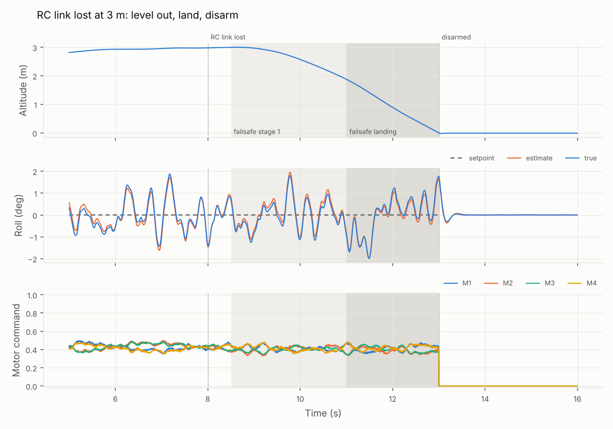
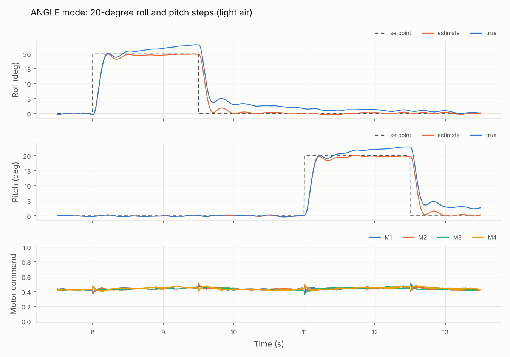
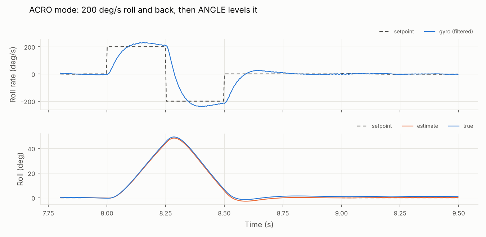

# firmware/ — our flight controller, and a simulator to fly it in

The flight-control code is written once, as portable C. It runs here against a physics model of
our 206 g drone, and later on the STM32F405 board. Every change gets flown in the simulator
and checked against the [requirements](../docs/01-requirements.md) before it goes anywhere near
a propeller. This is rung 1 of the [test ladder](../docs/02-architecture.md#test-ladder).

## What's here

```
core/     the flight controller: no hardware access, single-precision float (like the F405)
  flight.c    arming, failsafe, ANGLE/ACRO modes, angle and rate loops, I-term relax
  mahony.c    attitude estimator (gyro + accelerometer)
  pid.c       PID with derivative on measurement and a clamped integral
  mixer.c     quad-X mixer with desaturation (Betaflight motor order)
  filter.c    PT1, biquad low-pass and notch filters
  fc_math.c   vectors and quaternions
sim/      the simulator
  quad_model.c  rigid-body physics: motor lag, thrust and torque, drag, turbulence,
                ground contact, IMU with noise, bias and motor vibration
  sim.c         runner (physics 8 kHz, gyro 2 kHz, control loop 1 kHz) and the scenarios
  checks.c      requirement checks, as a Markdown report
  main.c        the `quadsim` command
tests/    unit tests for the core
tools/    plot_run.py: plots a flight log
results/  the latest requirement report and plots
```

## Build and run

You need a C compiler and CMake. The plots also need Python with matplotlib.

```bash
cmake -S drone/firmware -B build && cmake --build build
ctest --test-dir build --output-on-failure      # unit tests + requirement checks

./build/quadsim list                            # the scenarios
./build/quadsim run link_loss --csv flight.csv  # fly one and log it
python3 drone/firmware/tools/plot_run.py flight.csv flight.png --panels alt,roll,motors
./build/quadsim check > drone/firmware/results/sim-report.md
```

Add `--seed N` to change the turbulence and sensor noise. The checks pass on every seed from 1
to 20.

## Results

**28 of 28 checks pass:** [results/sim-report.md](results/sim-report.md).

| What | Result | Limit |
|---|---:|---:|
| Hover in turbulence: tilt error, RMS (REQ-P4) | 1.0° | ≤ 2° |
| ANGLE mode, 20° step: rise time | 0.12 s | ≤ 0.30 s |
| ANGLE mode, 20° step: overshoot | < 1% | ≤ 15% |
| ACRO, 200°/s step: time to 90% | 0.07 s | ≤ 0.10 s |
| ACRO, 200°/s step: overshoot | 15% | ≤ 20% |
| Kill switch: switch off to motors commanded off (REQ-S2) | same 1 ms loop | ≤ 20 ms |
| Link lost (REQ-S4) | level at 0.5 s, landing at 3.0 s, touches down at 0.9 m/s, disarms | — |
| Arming (REQ-S1) | refused with the switch on at power-up, and refused at 30° of tilt | — |







### What the simulator taught us already

1. **The first tune overshot by ~22%.** Adding D gain, so its zero sits near the motors' 20 ms
   lag, fixed the rate loop's phase margin.
2. **More I gain halved the hover wobble, but made stick moves overshoot by 30%.** I-term relax
   fixed that: the integrator pauses while the stick is moving fast, the same idea as
   Betaflight's.
3. **In a sustained 20° bank, the attitude estimate drifts by about 3°.** You can see it in the
   angle-step plot: the "true" line creeps above the "estimate". The drone is accelerating
   sideways, so the accelerometer sees thrust, not gravity. We now trust the accelerometer less
   when it reads far from 1 g, which trimmed the drift from about 4° to about 3°. The full fix
   needs velocity from
   the optical flow sensor or GPS, which is the Block 4 estimator. Until then, a pilot in
   ANGLE mode will notice a slow lean after long fast passes.
4. **Our first ground model made calibration impossible.** Turbulence shook the drone while it
   sat on the ground, so gyro calibration kept restarting and it never armed. The physics fix
   was easy. The lesson for the real drone: **calibrate the gyro with the drone still on the
   ground, not in your hand.**

## What the model leaves out (for now)

The model is a first-order sketch, good enough to tune the loops' structure, not their final
numbers. It leaves out:

- battery voltage sag;
- motor and ESC non-linearity;
- the centre of mass sitting off-centre;
- ground effect and vortex ring state;
- frame flex beyond a simple vibration term;
- control-loop timing jitter.

Its constants also come from estimates. Block 0 replaces them with measurements:

| Constant | Measured by |
|---|---|
| Thrust and torque per motor | Thrust stand |
| Inertia | Swing test |
| Hover throttle and vibration spectrum | Betaflight blackbox logs |
| Motor time constant | Step test on the stand |

## Next steps

- **Model:** add battery sag and the measured thrust curve as soon as we have them.
- **Controller:** notch/RPM filtering (once bidirectional DShot gives us motor RPM), stick
  feedforward, and a throttle-dependent PID scale.
- **Drivers, when the hardware arrives:**
  1. ICM-42688-P over SPI, DShot300 by timer + DMA, CRSF receiver input and the log flash, on
     the Feather STM32F405 with a debugger.
  2. Then the same code on the GEPRC Taker board.
